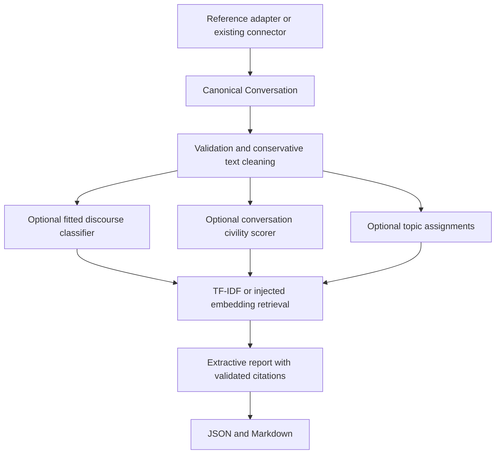

# Discussion Intelligence Toolkit

Turn a threaded conversation into a structured report whose discussion points cite the original utterances. This is the Break Through Tech AI Studio Fall 2026 team project.

The November integration provides an installable Python package, deterministic TF-IDF retrieval, extractive synthesis, JSON/Markdown reports, and an offline demo. Trained discourse, civility, embedding, and clustering models are optional injected components. The default demo requires no API key, model download, or full training corpus.

## Quickstart

Use Python 3.11 or later and [uv](https://docs.astral.sh/uv/). From a clone:

```bash
git clone https://github.com/Break-Through-Tech/Market-Research-1A-discussion-intelligence-toolkit.git
cd Market-Research-1A-discussion-intelligence-toolkit
uv sync --locked
uv run discussion-intelligence \
  --input data/coarse-discourse-reference-sample.jsonl \
  --query "RAID data drives" --top-k 3 --format markdown
```

The first installation downloads Python dependencies. Subsequent analysis and tests work offline with the environment installed:

```bash
uv run --offline python -m discussion_intelligence \
  --input data/coarse-discourse-reference-sample.jsonl \
  --query "RAID data drives" --top-k 3 --format json \
  --output /tmp/buildapc-report.json

# The second reference conversation; no query selects representative excerpts.
uv run --offline discussion-intelligence \
  --input data/coarse-discourse-reference-sample.jsonl \
  --conversation-index 1 --format markdown

uv run --offline pytest -q
```

The input is two small source-derived Reddit conversations. Its labels are reference annotations, not model predictions. Missing timestamps use the existing dataset normalizer's flagged epoch sentinel; report evidence dates are `null`. Missing authors use an explicitly flagged shared placeholder. The adapter preserves reply relationships and records any orphan repair.

See the committed [Markdown example](examples/buildapc-report.md), [JSON example](examples/buildapc-report.json), and [integration handoff](docs/ROHAN_INTEGRATION_HANDOFF.md).

## Python API

```python
from discussion_intelligence import analyze, EvidenceIndex
from discussion_intelligence.sample import load_reference_conversations

conversation = load_reference_conversations(
    "data/coarse-discourse-reference-sample.jsonl"
)[0]
report = analyze(conversation, query="RAID data drives", top_k=3)
print(report.to_markdown())

hits = EvidenceIndex(conversation).search("student discounts", top_k=2)
for hit in hits:
    print(hit.evidence.id, hit.score, hit.evidence.conversation_url)
```

`analyze()` accepts the existing `artifacts.schema.Conversation`. It validates a deep copy, so caller data and gold labels remain untouched. Nonempty input must be one connected tree with unique canonical IDs and valid speaker references. Empty input produces an empty report; invalid input raises. Empty, deleted, and removed content is excluded from retrieval.

Each substantive discussion point is an exact excerpt of its cited evidence. Reports retain full usable source text, IDs, parents, speaker references, supplied URLs, and available enrichments. Query retrieval returns positive cosine matches, without unrelated padding. Without a query, centroid similarity selects representative excerpts. Ties sort by canonical utterance ID.

## Architecture and current status



| Component | Status |
|---|---|
| Canonical schema and reference connectors | Existing advisor scaffolds; schema unchanged |
| Modeling datasets and leakage checks | Existing Gia Khanh contribution; [dataset contracts](docs/modeling-datasets.md) |
| Discourse models | Aisha's baselines and Franceli's context experiments exist; production fitted artifacts are not shipped |
| Discourse inference integration | Working text and target/parent adapters for caller-supplied fitted objects |
| Quality model | Gia's [PR #22](https://github.com/Break-Through-Tech/Market-Research-1A-discussion-intelligence-toolkit/pull/22) remains separate; conversation-level **P(civil)** adapter available |
| Topic clustering | Franceli's [issue #17](https://github.com/Break-Through-Tech/Market-Research-1A-discussion-intelligence-toolkit/issues/17); injected assignment interface available |
| Retrieval | Working deterministic TF-IDF/cosine; optional `embed(texts)` backend compatible with `TextEmbedder` |
| Report generation | Working extractive fallback, strict citation validation, JSON and Markdown |
| Injected synthesis | Quotation selection only; unknown citations, unretrieved evidence, and non-extractive claims trigger fallback |
| Free-form LLM synthesis | Not implemented; an API key is never required |

Component statuses distinguish unavailable models from failed models. The pipeline never creates default labels, quality scores, or embeddings. A conversation civility estimate is stored separately from the canonical per-utterance argument-quality slot. Agreement/disagreement/question excerpts require supplied or predicted discourse labels; these do not establish consensus, targets of disagreement, or unanswered questions. `open_questions` remains empty.

## Connecting fitted models

See [integration contracts](docs/integration-contracts.md) and the executable [artifact example](examples/fitted_model_integration.py). The pipeline never imports training experiments or calls `fit()`.

Optional installations are explicit:

```bash
uv sync --locked --extra embeddings  # sentence-transformers and its ML dependencies
uv sync --locked --extra reddit      # pandas, pyarrow, requests for reference ingestion
uv sync --locked --extra corpora     # ConvoKit corpus download/loading
```

Installing an extra does not select or download a model. Supply an already loaded embedder to `EvidenceIndex` or `analyze`. When PR #22 is approved and merged, its `SentenceTransformerEmbedder.embed(texts)` can be injected directly. This branch includes no code copied from that PR.

## Repository map

| Path | Purpose |
|---|---|
| `src/discussion_intelligence/` | Public pipeline, retrieval, report models, adapters, CLI |
| `artifacts/` | Canonical schema, connectors, dataset loaders, evaluation scaffolds |
| `utils/modeling_data/` | Existing deterministic dataset preparation and leakage checks |
| `experiments/franceli/` | Training/evaluation experiments, separate from inference |
| `users/franceli/dataset_finalization/` | Existing dataset cleaning and EDA |
| `utils/reddit_scraper.py` | Sonia's Arctic Shift scraper |
| `data/` | Small reference conversations, dataset card, split manifest; [data documentation](data/README.md) |
| `examples/` | Reproducible reports and fitted-model integration example |
| `tests/` | Original dataset tests and offline integration tests |
| `docs/` | Dataset documentation, adapter contracts, handoff, validation record, draft PR text |
| `pyproject.toml`, `uv.lock` | Package metadata, dependency extras, locked environment |

The wheel explicitly includes the toolkit, `artifacts`, `utils`, and `utils.modeling_data` Python modules. Raw corpora, checkpoints, exploration files, and caches are excluded. The CLI accepts an explicit input path; reference data is available in the repository/source distribution, not embedded in the wheel.

## Team and attribution

| Contributor | Verifiable repository contribution |
|---|---|
| Aisha Mouss | Majority-class and TF-IDF + Logistic Regression baselines (`b2624bf`) |
| Franceli Gonzalez | Baseline integration, context-aware discourse classifier and evaluation, dataset cleaning/EDA; clustering issue #17 |
| Gia Khanh (Gin-CS) | Modeling-data preparation, deterministic splits/leakage checks; quality and embedding work in unmerged PR #22 |
| Sonia Tyburczy | Arctic Shift Reddit scraper (`02531f1`) |
| Rohan Verma (rverma44-sudo) | November integration implementation prepared by the coding agent on Rohan's branch for his review; no personal-authorship claim |

At the audit base `e734489`, the original tests passed **36/36**. Franceli reports held-out discourse macro F1 **0.4214** on 9,555 examples in her experiment documentation; this branch does not rerun that training/evaluation or claim model accuracy from integration tests. Actual branch test and demo results are recorded in [validation](docs/integration-validation.md).

## Development and evaluation

```bash
uv sync --locked
uv run --offline ruff check src/discussion_intelligence tests/integration examples/fitted_model_integration.py
uv run --offline ruff format --check src/discussion_intelligence tests/integration examples/fitted_model_integration.py
uv run --offline pytest -q
uv build
```

CI runs lint, tests, the reference demo, and package builds on Python 3.11–3.13. Dependency installation needs network access; the tests and demo do not. No large dataset or model download is part of CI.

The starter `CgaCmvLoader` now follows a linear reply chain, excludes the final outcome before taking the context limit, and hashes a shared pair key when available. This intentionally changes leaky short-thread examples and some hash split assignments. Malformed chains raise instead of guessing an outcome. It does not replace Gia's official-split benchmark loader or reproduce PR #22's metrics.

Before December, export/version fitted model artifacts, integrate reviewed clustering and quality work, and evaluate retrieval recall@k plus human-reviewed report coverage and citation usefulness on held-out threads. Exact quotations establish source attribution, not factual correctness, completeness, or human-rated summary quality.

Read [Challenge-Project-Overview.md](Challenge-Project-Overview.md) for advisor expectations and monthly milestones. Training, dataset, and report changes should remain reviewable through issues and draft PRs.

## License

License decision pending advisor and program approval. No license is added by this integration.
