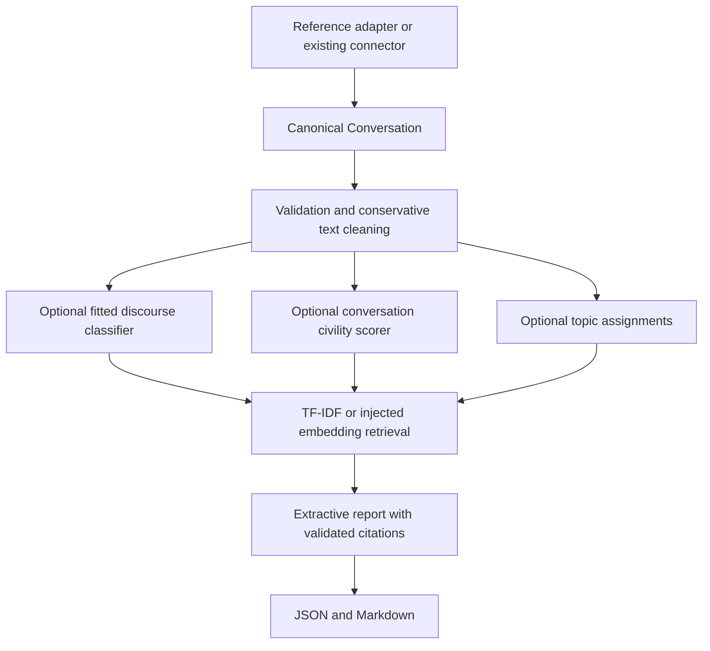

# Discussion Intelligence Toolkit

Turn a threaded conversation into a structured report whose discussion points cite the original utterances. This is the Break Through Tech AI Studio Fall 2026 team project.

The November integration provides an installable Python package, deterministic TF-IDF retrieval, extractive synthesis, JSON/Markdown reports, and an offline demo. Trained discourse, civility, embedding, and clustering models are optional injected components. The default demo requires no API key, model download, or full training corpus.

## Quickstart

Use Python 3.11 or later and [uv](https://docs.astral.sh/uv/). From a clone:

```bash
git clone https://github.com/Break-Through-Tech/Market-Research-1A-discussion-intelligence-toolkit.git
cd Market-Research-1A-discussion-intelligence-toolkit
uv sync --locked
uv run discussion-intelligence \
  --input data/coarse-discourse-reference-sample.jsonl \
  --query "RAID data drives" --top-k 3 --format markdown
```

The first installation downloads Python dependencies. Subsequent analysis and tests work offline with the environment installed:

```bash
uv run --offline python -m discussion_intelligence \
  --input data/coarse-discourse-reference-sample.jsonl \
  --query "RAID data drives" --top-k 3 --format json \
  --output /tmp/buildapc-report.json

# The second reference conversation; no query selects representative excerpts.
uv run --offline discussion-intelligence \
  --input data/coarse-discourse-reference-sample.jsonl \
  --conversation-index 1 --format markdown

uv run --offline pytest -q
```

The input is two small source-derived Reddit conversations. Its labels are reference annotations, not model predictions. Missing timestamps use the existing dataset normalizer's flagged epoch sentinel; report evidence dates are `null`. Missing authors use an explicitly flagged shared placeholder. The adapter preserves reply relationships and records any orphan repair.

See the committed [Markdown example](examples/buildapc-report.md), [JSON example](examples/buildapc-report.json), and [integration handoff](docs/ROHAN_INTEGRATION_HANDOFF.md).

Run both real reference threads through validation, retrieval and grounded JSON/Markdown reporting:

```bash
uv run --offline python examples/end_to_end_demo.py
```

This creates a fresh temporary directory, prints its location and each component's actual status, and preserves source IDs and citations. The demo uses the documented RAID and karma questions; it is not a generalization benchmark. `--output-dir PATH` requires a new directory and never overwrites existing output. An explicit `--trusted-bundle PATH` reuses the CLI's fitted-owner-model loader; missing models remain unavailable. No API key, training, model download or paid service is needed for the default demo.

## Python API

```python
from discussion_intelligence import analyze, EvidenceIndex
from discussion_intelligence.sample import load_reference_conversations

conversation = load_reference_conversations(
    "data/coarse-discourse-reference-sample.jsonl"
)[0]
report = analyze(conversation, query="RAID data drives", top_k=3)
print(report.to_markdown())

hits = EvidenceIndex(conversation).search("student discounts", top_k=2)
for hit in hits:
    print(hit.evidence.id, hit.score, hit.evidence.conversation_url)
```

`analyze()` accepts the existing `artifacts.schema.Conversation`. It validates a deep copy, so caller data and gold labels remain untouched. Nonempty input must be one connected tree with unique canonical IDs and valid speaker references. Empty input produces an empty report; invalid input raises. Empty, deleted, and removed content is excluded from retrieval.

Each substantive discussion point is an exact excerpt of its cited evidence. Reports retain full usable source text, IDs, parents, speaker references, supplied URLs, and available enrichments. Query retrieval returns positive cosine matches, without unrelated padding. Without a query, centroid similarity selects representative excerpts. Ties sort by canonical utterance ID.

## Architecture and current status



| Component | Status |
|---|---|
| Canonical schema and reference connectors | Existing advisor scaffolds; schema unchanged |
| Modeling datasets and leakage checks | Existing Gia Khanh contribution; [dataset contracts](docs/modeling-datasets.md) |
| Discourse models | Aisha's baselines and Franceli's context experiments exist; production fitted artifacts are not shipped |
| Discourse inference integration | Working text and target/parent adapters for caller-supplied fitted objects |
| Quality model | Gia's [PR #22](https://github.com/Break-Through-Tech/Market-Research-1A-discussion-intelligence-toolkit/pull/22) remains separate; conversation-level **P(civil)** adapter available |
| Topic clustering | Franceli's [issue #17](https://github.com/Break-Through-Tech/Market-Research-1A-discussion-intelligence-toolkit/issues/17); injected assignment interface available |
| Retrieval | Working deterministic TF-IDF/cosine; optional `embed(texts)` backend compatible with `TextEmbedder` |
| Report generation | Working extractive fallback, strict citation validation, JSON and Markdown |
| Injected synthesis | Quotation selection only; unknown citations, unretrieved evidence, and non-extractive claims trigger fallback |
| LLM synthesis | Aisha's exact-quotation provider is in separate [PR #29](https://github.com/Break-Through-Tech/Market-Research-1A-discussion-intelligence-toolkit/pull/29); the default extractive path requires no API key. Free-form abstraction remains unsupported. |

Component statuses distinguish unavailable models from failed models. The pipeline never creates default labels, quality scores, or embeddings. A conversation civility estimate is stored separately from the canonical per-utterance argument-quality slot. Agreement/disagreement/question excerpts require supplied or predicted discourse labels; these do not establish consensus, targets of disagreement, or unanswered questions. `open_questions` remains empty.

| Path | Purpose | Owner |
|---|---|---|
| `Challenge-Project-Overview.md` | Challenge brief, milestones, resources, advisor expectations | Challenge Advisor |
| `Getting-Started-for-Fellows.md` | BTT orientation and initial repo guidance | Challenge Advisor / Fellows |
| `README.md` | Living project home, progress log, and final portfolio artifact | Fellows |
| `notebooks/` | EDA, modeling, evaluation, and demo notebooks | Fellows |
| `utils/` | Helper modules, including `utils/modeling_data/` (modeling datasets and splits) and `utils/quality/` (quality scoring and embeddings) | Fellows |
| `data/` | Small metadata files, data dictionaries, links to external datasets, and tracked split manifests in `data/splits/` | Fellows |
| `docs/` | Design notes, e.g. `docs/modeling-datasets.md` and `docs/quality-scoring.md` | Fellows |
| `tests/` | Pytest suite (`uv run --no-project --with pydantic --with pytest pytest tests`) | Fellows |
| `pyproject.toml` / `uv.lock` | Python package metadata, dependency groups, and locked environment once package scaffolding is added | Fellows |
| `requirements.txt` | Legacy scaffold file from the template; migrate dependencies to `pyproject.toml` and `uv.lock` before adding project packages | Fellows |
| `.gitignore` | Files that must stay out of version control | Fellows |

## Connecting fitted models

See [integration contracts](docs/integration-contracts.md) and the executable [artifact example](examples/fitted_model_integration.py). The pipeline never imports training experiments or calls `fit()`.

The normal CLI can explicitly load a model-owner bundle. **Only supply files you trust: pickle/joblib deserialization can execute code.** Bundle validation happens after loading and cannot make an untrusted artifact safe. Without `--trusted-bundle`, the CLI never loads an artifact and keeps its existing behavior.

```bash
# Replace this path with a trusted bundle exported by the model owner.
uv run --offline discussion-intelligence \
  --input data/coarse-discourse-reference-sample.jsonl \
  --trusted-bundle /path/to/trusted-fitted-models.joblib \
  --query "RAID data drives" --top-k 3 --format json

# Self-contained synthetic interface checks; no production artifacts required.
# Creates tiny fitted sklearn objects in temporary test directories and runs
# both the CLI and the fitted-model example. NOT production model results.
uv run --offline pytest -q tests/integration/test_trusted_bundles.py
```

Supported bundle keys are `discourse_model` (text classifier), or `context_model` with both `target_vectorizer` and `parent_vectorizer`; `civility_model` with optional `civility_model_name`; `topic_clusterer` (`assign` interface); and `embedder` (`embed` interface). Context objects take precedence if both classifiers are present, matching the existing example. Missing components stay unavailable; supplied components that fail stay explicitly failed. Predictions retain source IDs and never use gold annotations. Civility remains a conversation-level estimate. Model classes and compatible dependencies must already be installed; loading a bundle does not install dependencies or select/download a checkpoint.

Optional installations are explicit:

```bash
uv sync --locked --extra embeddings  # sentence-transformers and its ML dependencies
uv sync --locked --extra reddit      # pandas, pyarrow, requests for reference ingestion
uv sync --locked --extra corpora     # ConvoKit corpus download/loading
```

Installing an extra does not select or download a model. Supply an already loaded embedder to `EvidenceIndex` or `analyze`. When PR #22 is approved and merged, its `SentenceTransformerEmbedder.embed(texts)` can be injected directly. This branch includes no code copied from that PR.

## Evaluation and review demos

The [curated retrieval evaluation](docs/retrieval-evaluation.md) measures the existing retriever on 10 source-inspected queries from the two reference threads. Its judgments are agent-drafted proposals for Franceli to review, **not an independently annotated held-out benchmark**. The committed [results](examples/retrieval-evaluation.json) retain both successful retrieval and known failures.

```bash
uv run --offline python examples/evaluate_retrieval.py
uv run --offline python examples/synthesis_provider_demo.py --mode fabricated
```

The second command demonstrates rejection of an unsupported claim and safe extractive fallback using a deterministic mock; **no LLM executes**. `--mode quote` demonstrates an accepted quotation, and `--mode error` demonstrates a provider exception.

For Gia's #26 review, see the [proposed report contract](docs/report-contract-proposal.md), [JSON Schema snapshot](examples/insight-report.schema.json), and [actual karma sample report](examples/karma-report.md). Report v1 fields, presentation and exact-quotation policy remain unchanged. The [November team audit](docs/november-team-audit.md) separates implemented code from pending artifacts and owner decisions.

## Repository map

| Path | Purpose |
|---|---|
| `src/discussion_intelligence/` | Public pipeline, retrieval, report models, adapters, CLI |
| `artifacts/` | Canonical schema, connectors, dataset loaders, evaluation scaffolds |
| `utils/modeling_data/` | Existing deterministic dataset preparation and leakage checks |
| `experiments/franceli/` | Training/evaluation experiments, separate from inference |
| `users/franceli/dataset_finalization/` | Existing dataset cleaning and EDA |
| `utils/reddit_scraper.py` | Sonia's Arctic Shift scraper |
| `data/` | Small reference conversations, dataset card, split manifest; [data documentation](data/README.md) |
| `examples/` | Reproducible reports and fitted-model integration example |
| `tests/` | Original dataset tests and offline integration tests |
| `docs/` | Dataset documentation, adapter contracts, handoff, validation record, draft PR text |
| `pyproject.toml`, `uv.lock` | Package metadata, dependency extras, locked environment |

The wheel discovers regular packages only under the toolkit, `artifacts`, and `utils` namespaces. This includes future owner subpackages such as `utils.quality` when their reviewed code lands, without importing or copying that code into this branch. Raw corpora, checkpoints, exploration files, and caches are excluded. The CLI accepts an explicit input path; reference data is available in the repository/source distribution, not embedded in the wheel.

See [current integration readiness and owner handoffs](docs/INTEGRATION_READINESS.md). Compatibility tests for PR #22/#29 are explicit skips when the owner's modules are absent; they execute against those actual modules when present. Aisha's mocked client validates integration without a live API call. Successful synthetic/interface tests do not mean production models or a live LLM were evaluated.

## Team and attribution

| Contributor | Verifiable repository contribution |
|---|---|
| Aisha Mouss | Majority-class and TF-IDF + Logistic Regression baselines (`b2624bf`); exact-quotation LLM provider in PR #29 |
| Franceli Gonzalez | Baseline integration, context-aware discourse classifier and evaluation, dataset cleaning/EDA; clustering issue #17 |
| Gia Khanh (Gin-CS) | Modeling-data preparation, deterministic splits/leakage checks; quality and embedding work in unmerged PR #22 |
| Sonia Tyburczy | Arctic Shift Reddit scraper (`02531f1`) |
| Rohan Verma (rverma44-sudo) | November integration implementation prepared by the coding agent on Rohan's branch for his review; no personal-authorship claim |

At the audit base `e734489`, the original tests passed **36/36**. Franceli reports held-out discourse macro F1 **0.4214** on 9,555 examples in her experiment documentation; this branch does not rerun that training/evaluation or claim model accuracy from integration tests. Actual branch test and demo results are recorded in [validation](docs/integration-validation.md).

## Development and evaluation

The Coarse Discourse modeling splits, label mapping, and leakage checks are documented in `docs/modeling-datasets.md`. The CGA-CMV quality target, context rules, and pair-preserving splits are documented in `docs/quality-scoring.md`.

```bash
uv sync --locked
uv run --offline ruff check src/discussion_intelligence tests/integration examples/fitted_model_integration.py
uv run --offline ruff format --check src/discussion_intelligence tests/integration examples/fitted_model_integration.py
uv run --offline pytest -q
uv build
```

CI runs lint, tests, the reference demo, and package builds on Python 3.11–3.13. Dependency installation needs network access; the tests and demo do not. No large dataset or model download is part of CI.

The starter `CgaCmvLoader` now follows a linear reply chain, excludes the final outcome before taking the context limit, and hashes a shared pair key when available. This intentionally changes leaky short-thread examples and some hash split assignments. Malformed chains raise instead of guessing an outcome. It does not replace Gia's official-split benchmark loader or reproduce PR #22's metrics.

Before December, export/version fitted model artifacts, integrate reviewed clustering and quality work, and evaluate retrieval recall@k plus human-reviewed report coverage and citation usefulness on held-out threads. Exact quotations establish source attribution, not factual correctness, completeness, or human-rated summary quality.

1. Majority-class or constant-score baseline.
2. TF-IDF plus logistic regression or linear regression.
3. Sentence-transformer embeddings plus a simple classifier, regressor, or clustering model.
4. Fine-tuned DistilBERT or another compact transformer for supervised tasks.
5. Retrieval-grounded LLM synthesis after evidence extraction and retrieval are working.

Document each model experiment:

| Date | Task | Model | Data Split | Metric | Result | Notes |
|---|---|---|---|---|---:|---|
| 2026-10-31 | Quality scoring (CGA-CMV civility) | Length + logistic regression | Official test (1,364 threads) | ROC-AUC | 0.559 | Shape-only baseline; constant scorer is 0.500 |
| 2026-10-31 | Quality scoring (CGA-CMV civility) | TF-IDF + logistic regression | Official test (1,364 threads) | ROC-AUC | 0.611 | Spearman 0.192, Brier 0.241 |
| 2026-10-31 | Quality scoring (CGA-CMV civility) | all-MiniLM-L6-v2 embeddings + logistic regression | Official test (1,364 threads) | ROC-AUC | 0.647 | Spearman 0.255, Brier 0.234 |
| 2026-10-31 | Quality scoring (CGA-CMV civility) | all-mpnet-base-v2 embeddings + logistic regression | Official test (1,364 threads) | ROC-AUC | 0.664 | Spearman 0.283, Brier 0.230; see `docs/quality-scoring.md` |

## Evaluation Plan

Use task-specific metrics. Do not rely on generic accuracy alone.

| Component | Primary Metrics | What the Metric Checks |
|---|---|---|
| Discourse-act classifier | Macro F1, per-class F1, confusion matrix | Whether minority discourse labels are handled well |
| Quality scorer | MAE, Spearman correlation | Whether predicted scores match level and ranking |
| Topic clustering | Silhouette score, sampled cluster coherence review | Whether clusters are separated and interpretable |
| Retrieval | Recall@k on hand-written thread questions | Whether cited evidence can be retrieved |
| LLM synthesis | Claim coverage, evidence-link accuracy, hallucination rate | Whether reports are useful and grounded |

For the final system, build a small held-out set of manually reviewed threads. Score final reports against human-written insight digests for claim coverage, evidence accuracy, and hallucination rate.

## Results and Key Findings

Update this section throughout the project. Include both successful and failed experiments when they changed the team’s direction.

Recommended result artifacts:

- EDA charts for thread size, depth, score, and label distributions
- baseline metrics before transformer fine-tuning
- final model comparison table
- error analysis examples
- retrieval examples showing query, retrieved comments, and missing evidence
- final insight-report examples with cited utterance IDs

## Final Demo Requirements

The final demo should show the complete path from input thread to structured report:

1. Load or ingest a threaded discussion.
2. Normalize it into the canonical conversation schema.
3. Run discourse, quality, embedding, clustering, and retrieval components.
4. Generate an insight report.
5. Show that each major claim links back to source comments.
6. Explain the evaluation results and remaining limitations.

The demo should run on student-accessible compute such as Google Colab.

## Milestones

| Month | Focus | Expected Outcomes |
|---|---|---|
| September | Data understanding and baselines | EDA, cleaned schema, baseline models, initial evaluation harness |
| October | Modeling | Discourse classifier, quality scorer, topic clustering, model comparisons |
| November | Integration | End-to-end `analyze(thread)` pipeline, retrieval, LLM synthesis, package structure |
| December | Polish and presentation | Final report, reproducible demo, recorded walkthrough, documented next steps |

## Next Steps

Track project-specific next steps here. Early candidates:

- Select target subreddit or discussion-domain verticals.
- Define the canonical conversation schema.
- Build or adopt a starter connector.
- Run first EDA on reconstructed threads.
- Establish baseline metrics before fine-tuning.
- Decide how final reports will cite supporting utterances.

Read [Challenge-Project-Overview.md](Challenge-Project-Overview.md) for advisor expectations and monthly milestones. Training, dataset, and report changes should remain reviewable through issues and draft PRs.

## License

License decision pending advisor and program approval. No license is added by this integration.
