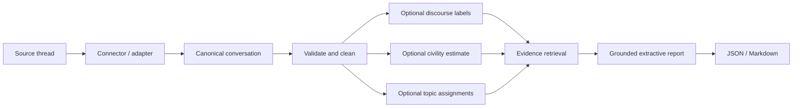

# Rohan's November integration handoff

Prepared for review on `rohan/november-toolkit-integration`, based on `e734489` (2026-11-07, America/Phoenix). This is implementation work prepared by the coding agent on Rohan Verma's branch for Rohan and the team to review. It is not a claim that Rohan personally authored the generated code, or that this branch authored the team's prior models.

## 1. The project in beginner-friendly terms

A conversation is a tree. The original post is its root; replies point to their immediate parents. Different source websites format posts differently, so connectors first translate them into the same Python objects:

- A `Speaker` identifies a participant within one conversation.
- An `Utterance` is a post/comment with text, its own ID, a parent ID, and a speaker reference.
- A `Conversation` owns those utterances and speakers and records the thread's source identity/title/URL.

The canonical schema lives in `artifacts/schema.py` and is unchanged by this branch. Pydantic checks field types, but the integration also checks relationships across objects: unique IDs, valid parents and speakers, one root, and no disconnected cycles.

The intended complete system is:



**Discourse classification** predicts what a comment is doing: asking, answering, agreeing, elaborating, and so on. **Quality scoring** must name its target. Gia's model estimates conversation civility, not whether an individual argument is strong. **Embeddings** turn text into numerical vectors that can capture related meanings. **Clustering** groups related vectors into themes. **Retrieval** chooses source comments relevant to a question. **Synthesis** assembles a readable report with evidence citations.

This branch supplies the integration, lexical retrieval, and extractive report stages. Models remain optional dependencies; a model's training experiment is not an installed inference artifact.

## 2. What existed before this branch

The audit checked the actual working tree, fetched remote refs, repository history, open PRs/issues, the challenge brief, README, schema, connector, corpora/evaluation modules, dataset documentation, experiment scripts, and tests.

At the audit:

- The active branch was the requested `rohan/november-toolkit-integration`.
- `HEAD`, `origin/main`, and the latest fetched main all pointed to `e734489`; divergence was `0 0`.
- The only local changes were Rohan's four untracked exploration files. Their SHA-256 values were recorded before edits and checked afterward. They were neither edited nor staged.
- The existing offline test suite passed **36 tests** before implementation.
- `artifacts/schema.py` supplied the stable Pydantic conversation contract.
- The connector and Reddit dump scaffold used top-level imports suitable for the starter notebook, but `artifacts.connector` could not be imported as an installed package without correcting those imports.
- `utils/modeling_data/` already normalized the corpus, pseudonymized speakers, separated gold annotations from predictions, made deterministic splits, and checked leakage. Its documentation records 9,483 input conversations, 98,305 retained labeled examples, and the normalizer's timestamp/orphan decisions.
- The tracked reference JSONL contained **two conversations with 7 and 4 utterances**. It was not canonical schema data and omitted timestamps and author identities.
- The baseline and context-classifier experiments trained on prepared datasets. No reusable saved classifier artifact, retrieval index, report schema, `analyze()` function, or `pyproject.toml` existed.
- `requirements.txt` was an empty legacy scaffold. No dependency content needed migration.

### Current parallel work checked during the audit

[PR #22](https://github.com/Break-Through-Tech/Market-Research-1A-discussion-intelligence-toolkit/pull/22), head `c21747a`, was open and unmerged. It adds quality scorers, embeddings, experiments, and tests under Gia's paths. It explicitly leaves the starter loader unchanged. The integration does not copy, merge, or edit the PR's model code.

[Issue #17](https://github.com/Break-Through-Tech/Market-Research-1A-discussion-intelligence-toolkit/issues/17) concerns topic clustering. Franceli's comment on PR #22 states she is using MiniLM for that work. This branch supplies an assignment contract and grouping of supplied assignments; it does not implement another clustering algorithm.

The open-issue search returned #16 and #17; the open-PR search returned #22. Relevant fetched branches included Aisha's baseline branch, Franceli's baseline/classifier/data branches, Gia's dataset branch, and `issue-16-quality-scoring`. No branches were merged or rebased into this branch. GitHub had no November milestone object; the PR references the November integration milestone described in the challenge brief instead.

## 3. Team responsibilities supported by repository evidence

These are concrete repository contributions, not assertions about private team assignments or effort.

| Person | Verifiable contribution and evidence |
|---|---|
| Aisha Mouss | Majority-class and TF-IDF + Logistic Regression baselines and results, commit [`b2624bf`](https://github.com/Break-Through-Tech/Market-Research-1A-discussion-intelligence-toolkit/commit/b2624bf). The baseline notebook/results remain her work. |
| Franceli Gonzalez | Standardized-dataset baseline integration (`8e87ff1`), parent-context experiments (`93f1bcf` and later commits), held-out evaluation (`b8f9b2f`, documentation `bfe9931`), dataset cleaning/EDA (`2185d93`, merge `0cec3e5`), and her stated clustering work in PR #22's discussion. |
| Gia Khanh / Gin-CS | Modeling-data preparation (`d19e96c`), tests (`1e9ada2`), manifests/card (`a96cb92`), documentation (`3716e3b`), and quality/embedding work proposed in PR #22 (`fd0c301` through `c21747a`). |
| Sonia Tyburczy | Arctic Shift Reddit scraper and documentation update, commit [`02531f1`](https://github.com/Break-Through-Tech/Market-Research-1A-discussion-intelligence-toolkit/commit/02531f1). |
| Rohan Verma | Branch owner/reviewer of this agent-prepared November integration: package, inference interfaces, retrieval, grounded reports, demo, tests, packaging corrections, loader safety correction, and handoff. This description does not claim personal authorship of generated code or ownership of teammates' models. |

Franceli's documentation reports held-out accuracy 0.5604, macro F1 0.4214, weighted F1 0.5622 over 9,555 examples. Those are her recorded results, not a model evaluation rerun by this integration. PR #22 reports civility/derailment experiments, not per-comment argument-strength results. Neither metric set should be relabeled as this branch's accuracy.

## 4. Significant files created or changed

### Runtime and packaging

| File | Change/purpose |
|---|---|
| `src/discussion_intelligence/__init__.py` | Public `analyze`, `EvidenceIndex`, `InsightReport`, and existing canonical types. |
| `src/discussion_intelligence/__main__.py` | `python -m discussion_intelligence` entry point. |
| `src/discussion_intelligence/validation.py` | Revalidation/copying, unique source-prefixed IDs, valid speaker/parent links, connected-tree checks, conservative whitespace cleaning. |
| `src/discussion_intelligence/retrieval.py` | Real TF-IDF index, cosine query/centroid ranking, deterministic ties, source-preserving hits, injected embedding backend. |
| `src/discussion_intelligence/reports.py` | Strict report/evidence/claim/status models, quotation/citation checks, JSON and safe readable Markdown. |
| `src/discussion_intelligence/adapters.py` | Immutable model inputs; discourse, civility, clustering, embedding-compatible and synthesis contracts; working fitted text/context/civility adapters. |
| `src/discussion_intelligence/pipeline.py` | Stage orchestration, atomic validated enrichments, failure isolation, retrieval and extractive report assembly. |
| `src/discussion_intelligence/sample.py` | Typed reference-format adapter using the existing dataset normalizer; missing-time/author provenance. |
| `src/discussion_intelligence/cli.py` | Reference JSONL or canonical JSON input, query/top-k/record selection, JSON/Markdown output. |
| `pyproject.toml` | Build metadata, explicit package list, core/optional/dev dependencies, CLI, pytest and Ruff settings. |
| `uv.lock` | Resolved core and optional dependency environment. |
| `MANIFEST.in` | Explicit source archive content and exploration-file/corpus exclusions; includes the small reference sample and tests/docs/examples. |
| `.gitignore` | Local environment, build, cache, model artifact, and credential exclusions. The four original exploration files remain untracked. |
| `artifacts/__init__.py`, `utils/__init__.py` | Make existing reusable modules installable packages. |
| `artifacts/connector.py` | Package-relative schema import with legacy notebook import compatibility. |
| `artifacts/reddit_dump.py` | Equivalent package/legacy import compatibility for the reference connector. |
| `artifacts/corpora.py` | Starter CGA-CMV outcome exclusion, linear-chain validation, shared pair-key splitting, and metadata. No quality-model implementation is added here. |

### Tests, examples, and project documentation

| File | Change/purpose |
|---|---|
| `tests/conftest.py` | Adds a small canonical conversation fixture alongside existing fixtures. |
| `tests/integration/test_retrieval.py` | Ranking, source references, empty/deleted/no-match cases, IDs/tree failures, stable ties, embedding validation/fallback. |
| `tests/integration/test_pipeline_reports.py` | Honest reduced mode, serialization/citations, nonmutation, optional failures, synthesis rejection, supplied-score scope and evidence integrity. |
| `tests/integration/test_sample_cli.py` | Both real samples, sentinel/author handling, malformed source records, canonical input, CLI output and errors. |
| `tests/integration/test_model_adapters.py` | Real small fitted sklearn models, target/parent feature order, no inference-time fitting, civility scope and chronology. |
| `tests/integration/test_cga_loader.py` | Excludes outcome from short civil/derailed threads, limits context after exclusion, pair disjointness, malformed-chain and limit errors. |
| `.github/workflows/tests.yml` | Linux Python 3.11–3.13 checks: install locked dependencies, lint/format, offline tests/demo, build. |
| `examples/buildapc-report.json` | Reproducible real-reference JSON result for the RAID query. |
| `examples/buildapc-report.md` | Human-readable result with local evidence anchors and the supplied thread URL. |
| `examples/fitted_model_integration.py` | Runnable trusted-artifact injection example; no model download or training. |
| `README.md` | Correct clone path and actual installation, demo, API, status, attribution and limitations. Replaces speculative scaffold claims. |
| `docs/integration-contracts.md` | Precise model interfaces, feature order, quality semantics, artifact/export and synthesis contracts. |
| `docs/integration-validation.md` | Executed validation commands, real results, dependencies and limitations. |
| `docs/ROHAN_INTEGRATION_HANDOFF.md` | This learning and review document. |
| `docs/ROHAN_DRAFT_PR.md` | Review-ready November integration PR description and reproduction commands. |

Unchanged: canonical schema, dataset normalization and split contracts, teammates' experiments/checkpoints, and the original four exploration files. No license, large corpus, secret, checkpoint, or cache is committed.

## 5. End-to-end execution, step by step

1. **Read input.** The demo reads a reference JSONL record. A real connector can instead supply a canonical `Conversation`. `--canonical` reads one serialized canonical JSON object.
2. **Normalize the reference.** Typed source records become existing `RawUtterance` objects, then use `normalize_conversation`. IDs receive the `reddit:` prefix. Source labels go to `metadata.discourse_act_gold`. Missing dates use the established flagged UTC epoch sentinel. Missing speakers share an explicitly flagged unknown placeholder; that is not an inferred identity or deleted account. Orphans follow the existing root-reattachment rule, retaining `source_parent_id`.
3. **Validate a copy.** Check Pydantic field constraints and thread-wide ID/graph invariants. Do not modify the caller's original object or recompute source depths. Empty conversations are valid empty analysis inputs.
4. **Preprocess conservatively.** Collapse whitespace into a separate cleaned variant. Keep raw source text. Exclude empty/deleted/removed text from model inputs and retrieval, while the original conversation keeps its tree.
5. **Prepare model inputs.** Use parent-before-child traversal, with text and parent text but no gold labels or annotation metadata. Missing/deleted parent text becomes empty. Missing dates become `None` in these inputs.
6. **Run supplied models.** Predict discourse labels, score the conversation's civility, and assign topic IDs if injected components exist. Validate returned IDs, label inventories, and score bounds before acceptance. Failed optional components leave a failure status while analysis continues. No default score/label is fabricated.
7. **Index evidence.** TF-IDF weights words by their frequency within this thread. Cosine similarity compares vector directions. An injected `embed(texts)` object can replace TF-IDF. Validate its array shape, dimensions, and finite values. If embedding retrieval fails, use TF-IDF.
8. **Retrieve.** A query selects up to `top_k` positive-similarity comments. Unknown vocabulary/empty queries return no matches. Without a query, similarity to the conversation centroid selects representative comments. Equal scores sort by canonical ID.
9. **Assemble points.** The default selects a prefix of at most 400 characters from each retrieved comment. These are quotations of participant statements, not verified facts. At most three form the short summary. Supplied cluster IDs group the selected excerpts; otherwise there is one discussion-excerpts section. All usable source comments remain in the evidence map.
10. **Validate synthesis if supplied.** A provider only receives copies of retrieved evidence. Accept its selection only when every point exactly quotes every attached source citation. Reject unknown, duplicate, or unretrieved citations and invented/paraphrased claims. On rejection, retain deterministic extraction.
11. **Serialize.** JSON preserves structured evidence and component states. Markdown shows quotations linked to actual source IDs through local anchors; it also includes supplied source/thread URLs. Serialization rechecks evidence and quotations after mutation.

## 6. What is implemented, optional, or intentionally limited

**Fully working:** installable package/CLI; canonical input validation; source adaptation; text cleanup/exclusion; TF-IDF retrieval; optional embedding cosine retrieval; deterministic extractive reports; strict evidence references; JSON/Markdown; existing-label preservation; runtime-failure isolation; fitted text/context/civility adapters; supplied topic grouping; offline tests/demo; package builds; starter-loader safety correction.

**Optional and functional when supplied:** discourse classifier, conversation civility scorer, embedder, cluster assignment object, and quote-selecting synthesis provider. The contracts and adapters are not claims that production models are bundled. Small fitted sklearn models and deterministic test doubles verify the interface behavior.

**Not shipped:** Franceli's fitted production classifier/vectorizers; Gia's unmerged quality code/trained artifacts; Franceli's clustering implementation; a sentence-transformer checkpoint; LLM client/API; free-form abstractive synthesis; learned per-comment argument quality; inferred consensus or resolution of questions. `open_questions` is an empty field reserved for evidence-supported future work.

**Existing argument-quality values:** if a caller supplies a canonical `Utterance.quality_score`, it is preserved in evidence as `argument_quality_score`. It is not produced by this branch, and it does not make a civility model available. Conversation civility is a separate value with scope, target, model name, and context IDs.

## 7. Decisions, tradeoffs, assumptions, and limitations

- **Reuse the schema and normalizer.** Changing schema v1.0 or duplicating normalization would create competing contracts. Source depth remains unchanged, including for previously repaired orphans.
- **TF-IDF first.** It is deterministic and explainable without a model download. It misses synonyms and can emphasize the longest/most central comment instead of the most useful idea. Centroid selection is not learned theme discovery.
- **Exact extraction first.** Actual quotations and valid citations are checkable. Existence of a citation does not prove that an arbitrary paraphrase follows from it, so free-form claims are rejected. Quotations can still contain incorrect source statements or omit context.
- **Explicit availability.** Successful extraction does not imply trained models ran. Component states and prediction/assignment counts expose reduced mode and partial coverage.
- **IDs rather than positions.** Integrations return mappings keyed by canonical IDs. Text adapters validate parallel prediction lengths before mapping. Stable ID ordering resolves retrieval ties.
- **No inference-time training.** Model owners train/export/load once. `analyze` calls predict/transform/score/assign/embed only.
- **Civility semantics.** Quality is conversation-level P(civil). Real dates establish chronology when all are present; otherwise source traversal is used with a warning. A branched thread and missing timestamps cannot establish actual temporal order.
- **No fabricated interpersonal conclusions.** A disagreement label does not identify its target; a question label does not prove it is still unanswered. The output says labeled excerpts, not consensus or unresolved-question findings.
- **Preserve provenance.** Full raw text, cleaned text, IDs, parents, source metadata and supplied URLs remain available. The reference sample only supplies a thread URL; no per-comment permalink is invented.
- **Optional exceptions are visible.** Model failures do not hide invalid input. Invalid canonical threads raise before inference. Reported failures include exception types without exposing exception-message contents.
- **Packaging compatibility.** Existing `artifacts`/`utils` modules stay importable, and the old notebook import style is retained for reference connectors. The small sample/docs/tests ship in the source distribution; the wheel contains explicit Python packages.
- **Scope of evidence.** The report stores all usable utterances to keep context and model-score references resolvable; output size grows with thread length. Prefix extraction can cut sentences and may repeat similar comments. No recall/summary-quality benchmark claim follows from the unit suite.

## 8. Reproduce the demo

```bash
uv sync --locked
uv run --offline discussion-intelligence \
  --input data/coarse-discourse-reference-sample.jsonl \
  --query "RAID data drives" --top-k 3 --format json \
  --output /tmp/buildapc-report.json
uv run --offline discussion-intelligence \
  --input data/coarse-discourse-reference-sample.jsonl \
  --query "RAID data drives" --top-k 3 --format markdown \
  --output /tmp/buildapc-report.md
uv run --offline python -m discussion_intelligence \
  --input data/coarse-discourse-reference-sample.jsonl \
  --conversation-index 1 --format markdown
```

Dependency installation uses network access. Once installed, these commands need neither network nor an API key. Both reference threads were analyzed successfully. For the RAID query, the first result cites `reddit:t1_c6fwalq`, the actual reply discussing RAID/data drives. The committed examples use those same parameters. The source discussion is historical corpus data, not current hardware guidance.

## 9. Tests and evaluation

The audit baseline was **36 passed**. The completed local suite is **119 passed, 0 failed**, including those same 36 original tests. Main local validation uses uv's Python 3.12.15. Ruff checks and formatting checks pass on the new toolkit/tests/example. Source and wheel builds succeed; an isolated wheel install outside the checkout can import the canonical connector and produce the correct RAID source ID. Both distribution inventories exclude the four protected files and raw corpora.

The adapter tests use small real fitted scikit-learn models; the executable artifact example was also exercised with a synthetic fitted bundle in `/tmp`. These verify feature order, ID alignment, and inference behavior. They are not measured performance of the teammates' unavailable artifacts. The synthetic bundle is not committed.

Tests include retrieval ranking/no matches/empty content/duplicate and invalid IDs/determinism; canonical tree validation; evidence identity and raw-text integrity; JSON/Markdown/citations; missing timestamps/authors; gold-label isolation; optional provider exceptions and malformed outputs; target/parent feature construction; score scope and chronological sorting; rejected synthesis with fabricated text or unknown/unretrieved/duplicate IDs; and CGA-CMV outcome/pair controls.

Interim failures were corrected: a nested fixture file conflicted with the existing direct `conftest` import, and one raw-Markdown assertion ignored escaped IDs. A local archive-check script initially tried to parse `dist/.gitignore` as an archive; the corrected check inspects only wheels and `.tar.gz`. The final tests/build/inventory checks pass. No existing failure was present at the initial audit.

Detailed commands, dependency versions, validation boundaries, and final verification are in [integration-validation.md](integration-validation.md). CI is configured for Linux Python 3.11–3.13; its remote status must be checked on the PR before treating that matrix as validated.

## 10. Starter quality-loader safety correction

PR #22 points out that the old `CgaCmvLoader` took up to four comments and could include a short thread's final moderator-removed outcome. That lets a model see the answer it is supposed to predict. The old split also hashed each member of a matched pair separately.

The correction follows the existing linear chain from `reply_to`, even when timestamps tie or are missing. It drops the terminal outcome from **both** civil and derailed threads, then takes the configured prefix. Threads with no remaining context are skipped. Malformed/branched/disconnected chains raise instead of guessing. Reciprocal `pair_id` metadata names the partner conversation; both members hash the same smaller ID. Without a pair ID, the original conversation-ID hash is retained.

This changes short-thread training text and some split assignments when pairing is present. Recomputed metrics would not be directly comparable to the old leaky starter results. The constructor, labels, `ClassificationSplits`, and historical hash policy remain; metadata gains `pair_id`, `pair_group_id`, and `outcome_excluded`. The fix touches no file changed by PR #22's model implementation. It is a starter-loader correction, not Gia's model contribution or an official-split benchmark reproduction. Full-corpus counts were not recomputed. Gia's official-split loader should remain the benchmark path after review.

## 11. A two-minute team explanation

> I have a draft integration branch ready for review. The coding agent prepared the implementation on my branch, and I am reviewing it so I can explain and maintain it. It connects the existing canonical conversation schema to an installable analysis package.
>
> The default path runs without a paid API or a downloaded model. It validates a thread, keeps its original IDs and reply links, excludes unusable text, and uses TF-IDF plus cosine similarity to retrieve relevant comments. It then assembles a JSON or Markdown report from exact source excerpts. Every discussion point cites a real comment ID. The report says which models were unavailable, so the demo does not pretend the classifier or quality model ran.
>
> The team models connect through fitted-object adapters. Franceli's adapter uses her separate target and parent vectorizers in the same feature order as the experiments. Gia's score stays at the conversation level as probability of civility; it never becomes a per-comment argument-quality score. The clustering owner can provide ID-based assignments without my branch rebuilding her algorithm.
>
> Both tracked sample threads work, the original 36 tests still pass, and the full suite now passes 119 tests. I also fixed the starter quality loader's outcome leak and added regression tests. The next steps are team review, exporting versioned trained artifacts, integrating the approved model components, and evaluating retrieval and report usefulness on held-out threads before December.

## 12. Questions for the next meeting

1. Can Franceli export the fitted classifier **and both vectorizers**, with versions and preprocessing notes, without retraining during inference?
2. Should the final quality field explicitly remain conversation civility, and who owns any future argument-strength target?
3. After PR #22 merges, which embedder/model and cache policy should the final demo use?
4. What exact ID mapping and noise/unassigned convention will clustering issue #17 return?
5. Do we want a small number of distinct theme representatives rather than centroid-ranked prefixes? How should humans score theme coverage?
6. What held-out thread set and queries should define retrieval recall@k and citation usefulness?
7. Which conclusions count as enough evidence for consensus, explicit disagreement targets, and unresolved questions?
8. Can the schema owner approve nullable dates in a future version, replacing the documented sentinel?
9. Should this starter loader retain hash splits long term or explicitly redirect benchmark users to Gia's official-split loader?
10. Who will review the import-compatibility changes and decide the license with the advisor?

## 13. Connections to the existing work and December readiness

The dataset pipeline and this inference package share canonical schema objects and normalization decisions. Prepared classification examples remain the training interface; they are not replaced by reference samples. Gold annotations remain metadata. Franceli's trained context model can connect directly after artifact export. Gia's fitted scorer/embedding utility can connect after approval without copying its implementation. Franceli's cluster assignments will organize the same canonical IDs used by retrieval and reports.

Before the December deliverable:

1. Review/merge each contributor's PR through the team's normal process; this branch remains a draft and never merges itself.
2. Export/version trained artifacts and specify compatible package versions. Confirm parent cleaning, context ordering, label inventory, noise assignment, and output semantics with their owners.
3. Run an integrated real-model smoke test after those artifacts become available. Unit tests do not substitute for this.
4. Select held-out discussion threads with hand-written queries and evidence IDs. Measure retrieval recall@k and inspect missed evidence.
5. Evaluate report coverage, citation relevance, redundancy, and misrepresentation by human review. Quotation validation alone cannot measure these.
6. Decide whether free-form synthesis is needed. If so, add a local/open-model provider with separate factual/entailment validation and failure evaluation.
7. Improve long-thread performance/output size and extraction readability if observed use requires it.
8. Build the final notebook/demo walkthrough, final comparison tables, limitations, and presentation; obtain license approval before publication.

The branch provides a working, reproducible integration baseline for those final tasks. The review should focus on real behavior and interfaces, without treating pending models as shipped features.
