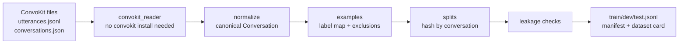

# Modeling Datasets and Splits

Issue #14 ("6. Prepare modeling datasets and splits"): normalize the labeled corpus to the canonical conversation schema, finalize the label mapping, build train/dev/test splits, check for leakage, and record dataset counts.

**Scope.** This covers the ConvoKit Coarse Discourse corpus, which feeds the discourse classifier (#15) and the baselines (#12, PR #18). CGA-CMV for quality scoring (#16) can reuse the same split and leakage modules; it is not built yet.

## Summary

| | Train | Dev | Test | Total |
|---|---:|---:|---:|---:|
| Conversations | 7,584 | 952 | 947 | 9,483 |
| Share of conversations | 80.0% | 10.0% | 10.0% | |
| Labeled examples | 79,010 | 9,740 | 9,555 | 98,305 |
| Examples where all 3 annotators agreed | 64.6% | 64.7% | 63.6% | |

All six leakage checks pass. The largest gap between the train label distribution and dev or test is 0.9 percentage points.

## Pipeline



| Module | Responsibility |
|---|---|
| `utils/modeling_data/convokit_reader.py` | Reads the downloaded corpus directory directly. Accepts both ConvoKit v1 (`user`, `reply-to`) and newer (`speaker`, `reply_to`) field names. |
| `utils/modeling_data/normalize.py` | Builds `artifacts.schema.Conversation` objects and handles the source's quirks (below). |
| `utils/modeling_data/labels.py` | Versioned raw-to-canonical label map, the drop list, and annotator agreement. |
| `utils/modeling_data/examples.py` | One `ClassificationExample` per usable labeled utterance, with thread context in metadata. |
| `utils/modeling_data/splits.py` | Conversation-level split assignment and the manifest CSV. |
| `utils/modeling_data/leakage.py` | Six checks with pass, warn, and fail statuses. |
| `utils/modeling_data/build.py` | Runs the steps above, writes the outputs, and provides the CLI and `load_prepared_splits()`. |

## Normalization decisions

| Source issue | Count | Handling |
|---|---:|---|
| No timestamps in the corpus | 115,827 (all) | `created_at` is set to the Unix epoch and `metadata.timestamp_missing = true`. A time-based split is not possible for this corpus. |
| Replies whose parent is missing from the release | 207 in 126 threads | Re-attached to the thread root so the schema's tree invariant holds. The original parent is kept in `metadata.source_parent_id`, and `depth` keeps the source value. |
| `[deleted]` or `[removed]` text | 1,017 | `is_deleted = true`. The utterance stays in the conversation but is excluded from modeling. |
| Empty or null text | 2,575 | Kept in the conversation and excluded from modeling. |
| `[deleted]` authors | 13,682 utterances | Mapped to one shared Speaker with `is_deleted = true`. |
| Reddit usernames | all | Pseudonymized to `anon_<sha256[:12]>` by default, so the outputs contain no Reddit handles. Use `--keep-usernames` to opt out. |
| Gold labels | all | Stored in `metadata.discourse_act_gold`, not in `Utterance.discourse_act`. That field is the slot the classifier writes predictions into, so keeping gold labels out of it means they cannot reach inference by accident. |

## Label mapping (v1.0)

Nine modeling classes. The only rename is `negativereaction` to `negative_reaction`, which matches the label names in `artifacts/corpora.py`.

| Label | Train share | | Label | Train share |
|---|---:|---|---|---:|
| answer | 41.2% | | disagreement | 3.4% |
| elaboration | 19.2% | | humor | 2.4% |
| question | 16.7% | | negative_reaction | 1.9% |
| appreciation | 8.6% | | announcement | 1.4% |
| agreement | 5.0% | | | |

The largest class is about 29 times the smallest, so models should be compared on macro F1 and per-class F1.

## Exclusions

Every one of the 115,827 utterances is either a modeling example or counted under exactly one exclusion reason:

| Reason | Utterances |
|---|---:|
| No majority label (all three annotators disagreed) | 12,277 |
| Label `other` (catch-all bucket, dropped as in `CoarseDiscourseLoader`) | 2,049 |
| Empty text | 2,268 |
| `[deleted]` / `[removed]` text | 928 |
| **Kept as examples** | **98,305** |

## Split strategy

- **Grouped by conversation.** Every utterance in a thread lands in the same split. Replies quote and answer each other, so a thread divided between train and test would leak test text into training.
- **Deterministic hashing.** A thread's split is `md5("{seed}:{conversation_id}")` bucketed at 10% / 10% / 80%. Adding, removing or re-filtering other threads never moves a thread to a different split.
- **Compatible with existing baselines.** The hashing is the same `_bucket_for` used by `artifacts.corpora.split_by_group`, so the thread-level assignment is identical to the one behind PR #18's baselines (verified: 0 mismatches). PR #18's dev set had 9,825 examples and this one has 9,740. The 85-example difference is exactly the `[deleted]` / `[removed]` utterances, which the original loader kept as text.
- **Not stratified by label.** With 9.4k threads, hashing already keeps label proportions within 0.9 percentage points of train, so stratification would add complexity without much benefit.

## Leakage checks

| Check | Fails or warns when | Result |
|---|---|---|
| `conversation_disjoint` | Any thread appears in two splits (fail) | pass: 9,397 threads with examples, each in one split |
| `example_disjoint` | Any example ID appears twice (fail) | pass: 98,305 unique |
| `manifest_consistency` | An example's split differs from its thread's manifest split (fail) | pass |
| `label_coverage` | A train label is missing from dev or test (warn) | pass: 9 of 9 labels in every split |
| `label_distribution` | Max per-label proportion gap is above 0.02 (warn) | pass: dev 0.0093, test 0.0046 |
| `text_overlap` | Dev or test text also appears verbatim in train with 8 or more tokens (warn) | pass: 1.5% to 1.6% overlap, all short replies such as "thanks!" or "yes"; 0 long overlaps |

Short overlapping texts are reported but not removed. Generic replies really do recur across unrelated threads, and removing them from dev and test would make evaluation look easier than real use.

## Outputs

| Path | Tracked? | Contents |
|---|---|---|
| `data/processed/coarse_discourse/conversations.jsonl` | no (100 MB) | Canonical `Conversation` per line |
| `data/processed/coarse_discourse/{train,dev,test}.jsonl` | no | `ClassificationExample` rows; load with `load_jsonl_classification` |
| `data/splits/coarse_discourse_split_manifest.csv` | **yes** (250 KB) | `conversation_id, subreddit, split` |
| `data/splits/coarse_discourse_dataset_card.json` | **yes** | Config, input SHA-256, label map, counts, exclusions, leakage report |

Example metadata includes `conversation_id`, `subreddit`, `title`, `depth`, `is_root`, `parent_id`, `parent_text`, `score` and `annotator_agreement`, so context-aware classifiers and high-agreement test subsets work without reprocessing.

## Reproducing

```bash
# 1. Download the corpus once (see data/README.md)
uv run --with convokit python -c "from convokit import download; print(download('reddit-coarse-discourse-corpus'))"

# 2. Build (about 3 seconds); exits 1 if a leakage check fails
uv run --no-project --with pydantic python -m utils.modeling_data.build

# 3. Use in a notebook or script
from utils.modeling_data.build import load_prepared_splits
splits = load_prepared_splits()   # ClassificationSplits(train, dev, test)
```

Options: `--seed`, `--dev-frac`, `--test-frac`, `--subreddits buildapc,techsupport` (for a domain-specific subset), `--keep-usernames`, and `--no-publish`.

Rebuilding from the same corpus file gives byte-identical outputs. The dataset card records the corpus file's SHA-256 so results can be traced to their exact input.

## Tests

```bash
uv run --no-project --with pydantic --with pytest pytest tests -q   # 34 tests, < 1 s
```

The tests use small synthetic corpora, so no download is needed. They cover the label mapping, tree invariants after normalization, orphan handling, username pseudonymization, keeping gold labels out of the prediction slot, exclusion accounting, deterministic splitting, equivalence with the existing loader's split, each leakage check catching an injected failure, byte-reproducible builds, the subreddit filter, and the CLI.

## Open questions for the team

1. **Timestamps (#10, schema).** `created_at` is required, but this corpus has none. The epoch sentinel works, but making `created_at` optional in a schema v1.1 would be more honest. That decision belongs to the schema owner.
2. **Packaging (#13).** There is no `pyproject.toml` yet, so commands use `uv run --no-project --with ...`. Once the environment setup lands, `pydantic` and `pytest` belong in it.
3. **Domain subset.** Should the classifier train on all 2,853 subreddits or on a vertical (for example, PC and tech help)? `--subreddits` supports either. The default is all subreddits, which gives the most data.
4. **CGA-CMV.** Quality scoring (#16) needs its own build. The split and leakage modules are corpus-agnostic, but the reader and normalizer are specific to Coarse Discourse.
